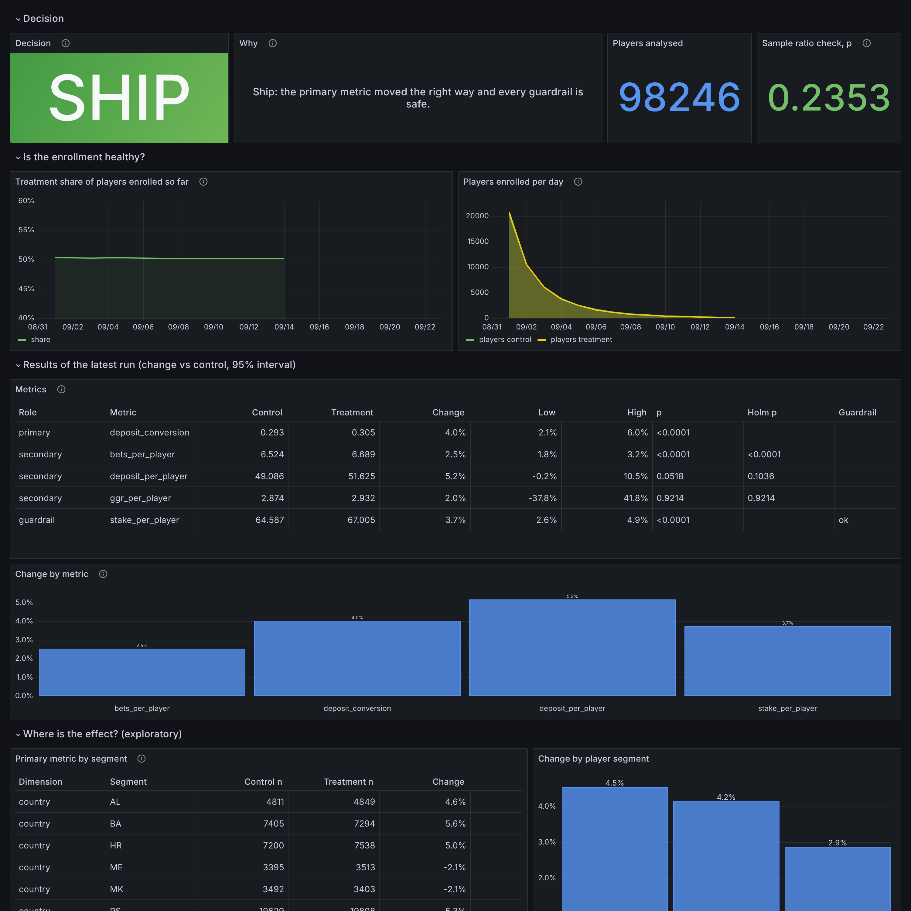
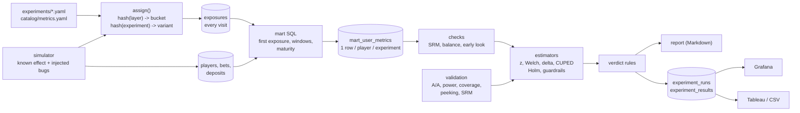
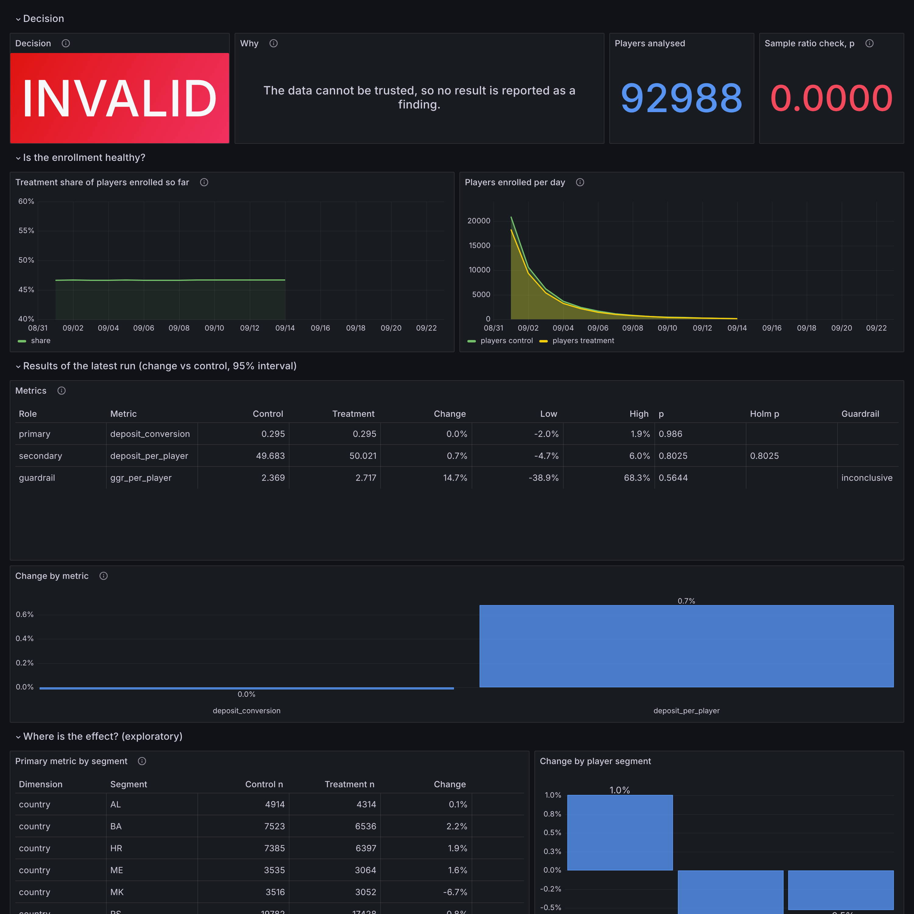

# Gamma · an A/B testing platform for an iGaming product

Experiments are decided by numbers, and the numbers are only as good as the plumbing under them:
who was put in which arm, whether that was logged once, whether the window was complete, whether the
metric has the unit that was randomised, whether the test was run on enough players, and whether
anyone peeked. Gamma is that plumbing plus the statistics, built so that every claim it makes
can be **checked against a world whose truth is known**.

Stage 1 is the data side: experiments as reviewed YAML, deterministic assignment, an exposure log,
ClickHouse marts with one row per player, and a simulator that plants one real effect, two false
alarms and two data-quality bugs. Stage 2 is the statistics, and the proof that they work. Stage 3
turns an analysis into a decision: a verdict by explicit rules, a report, results stored in ClickHouse
for Grafana and Tableau, and benchmarks.



## What it shows

| Area | How it is done here |
| --- | --- |
| Experiments as code | One YAML file per experiment: hypothesis, owner, layer, buckets, variants, primary / secondary / guardrail metrics, design (alpha, power, MDE). Loading refuses an unwritten hypothesis, an unknown metric, a first variant that is not `control` |
| Deterministic assignment | The variant is a pure function of (experiment, player): `blake2b` hash, no assignment table, same answer in every service and in an analyst's notebook. A golden test pins known values, because changing the hash silently re-randomises every running test |
| Layers | Experiments that must not share players live in one layer and own disjoint bucket ranges of 10,000; the loader refuses overlaps that run at the same time. Experiments in different layers overlap freely and stay independent, thanks to a per-experiment salt (chi-square on the cross-tab) |
| Marts | `mart_user_metrics`: one row per player per experiment, post-exposure and pre-exposure windows, built from the **first** exposure by one SQL statement; only players with a complete window are included; money in integer cents |
| Checks before estimates | Sample ratio mismatch (chi-square, p < 0.001), balance of the pre-period (Holm-adjusted), players who saw several arms excluded and counted, an early look flagged, an underpowered test flagged |
| Estimators | Two-proportion z for rates, Welch for money, **delta method** for ratios (margin, average stake), **CUPED** for variance reduction, percentile bootstrap as a cross-check; every interval also as a relative change |
| Several metrics | Primary at alpha; secondary adjusted with Holm; guardrails as one-sided **non-inferiority** tests with a margin: `ok`, `violated`, or `inconclusive`, which is not a pass |
| Planning | `gamma plan`: players per arm and days of enrollment from the pre-period, with and without CUPED |
| Looking early | O'Brien-Fleming group-sequential boundaries, computed by numerical integration; checked by simulation to hold 5% across 5 looks where naive peeking gives 13% |
| Verdict | `gamma report`: INVALID, WAIT, DO NOT SHIP, HOLD, SHIP, NO EFFECT or INCONCLUSIVE by ordered rules ([How a verdict is made](#how-a-verdict-is-made)), as a one-page Markdown report with the checks, results, segments and metric definitions |
| Results as data | Every run is stored (`experiment_runs`, `experiment_results`) with views of the latest run; Grafana and Tableau read conclusions instead of recomputing them; `gamma export` writes CSV |
| Dashboard as code | `grafana/build_dashboards.py` builds the dashboard JSON; CI fails if the committed JSON drifts |
| Tested against truth | The simulator is the ground truth. The mart is checked against an independent Python recomputation, the planted effect and bugs are found by the analysis, and [the methods themselves are validated by simulation](docs/validation.md) |

## Architecture



## Run it

Requirements: Docker with Compose v2, Python 3.11+.

```bash
make dev && . .venv/bin/activate   # the `gamma` command
make up       # ClickHouse and Grafana, then the schema
make sim      # 200k players, ~5.2M bets, then the marts of all three experiments
make plan E=welcome_bonus      # players per arm and days needed
make analyze E=welcome_bonus   # checks, then estimates
make report                    # verdict + report of every experiment into reports/, results into ClickHouse
make bench                     # scaling benchmarks in a scratch database
make validate                  # the statistics, checked by simulation (about 80 s), writes docs/validation.md
make test e2e                  # unit tests, then the end-to-end tests against the database
```

### Planning

```text
$ gamma plan welcome_bonus
welcome_bonus: alpha 0.05, power 80%, detect a +3.0% relative change
baselines come from the 7 days before exposure; 7,018 players enter per day

metric                baseline       sd     per arm    with CUPED     days
deposit_conversion       0.295    0.456      41,950        41,950     12.0
deposit_per_player      49.896  247.688     429,801       286,880    122.5
bets_per_player          6.553   13.437      73,341         5,284     20.9
ggr_per_player           2.741   92.982  20,065,164    19,972,147   5718.5
stake_per_player        65.024  278.550     320,077        14,056     91.2

days = how long the enrollment must run to reach `per arm` in both arms at this rate; this test enrolls for 14.
```

Read the last rows: a 3% change of *deposited amount* needs 430k players per arm (287k with CUPED),
and of *GGR* twenty million. Those metrics are noisy enough that a test cannot be decided on them
at this size; the experiment definitions use conversion and bets as primary metrics and turnover as
the revenue guardrail, and GGR is reported but never blocks a decision. Bets per player is the opposite:
the pre-period explains 93% of its variance, so CUPED cuts the sample from 73k to 5k per arm.

### A real effect

`welcome_bonus` raises the deposit rate of treated players by 6% and the bet rate by 2%.

```text
$ gamma analyze welcome_bonus
welcome_bonus: Raising the first-deposit bonus cap from 50 to 100 EUR makes more players deposit within 7 days of seeing the offer, without lowering revenue per player.
as of 2026-09-22 (planned horizon)

checks
  sample ratio   ok: control: 48937 (49.81% vs 50.00% planned), treatment: 49309 (50.19% vs 50.00% planned); chi2=1.4, p=0.235
  pre-period     pre_converted: p=0.134  pre_deposit_amount: p=0.629  pre_bets: p=0.007  pre_ggr: p=0.629  pre_stake: p=0.015  (balanced)
  several arms   0 players excluded
  power          48,937 per arm, 41,950 needed for +3% -> 86% power

          metric                 control  treatment   change        95% interval         p  note
primary   deposit_conversion       0.293      0.305    +4.0%      [+2.1%, +6.0%]  3.74e-05  CUPED -3% var, raw p=0.000225
secondary deposit_per_player      49.086     51.625    +5.2%     [-0.2%, +10.5%]    0.0518  CUPED -33% var, raw p=0.303; Holm p=0.104
secondary bets_per_player          6.524      6.689    +2.5%      [+1.8%, +3.2%]  9.93e-13  CUPED -93% var, raw p=0.25; Holm p=2.98e-12
secondary ggr_per_player           2.874      2.932    +2.0%    [-37.8%, +41.8%]     0.921  CUPED -0% var, raw p=0.976; Holm p=0.921
guardrail stake_per_player        64.587     67.005    +3.7%      [+2.6%, +4.9%]  1.62e-10  CUPED -96% var, raw p=0.135; guardrail ok (limit -5%)
```

What this output is for:

- **Conversion** went up about 4% (interval +2.1% to +6.0%). The deposit rate was raised 6%; the share of
  players with at least one deposit rises less because a rate saturates as a probability.
- **Bets per player** is the CUPED showcase: raw p = 0.25, CUPED p ~ 1e-12 on the same data, because the
  pre-period explains 93% of the variance. This is partly an artefact of the simulator, where a player's
  bet rate is a constant; real activity is noisier, 30 to 70% is a more typical reduction. Deposits show
  the realistic case: 33% less variance, and the interval narrows accordingly.
- **Holm** adjusts the three secondary metrics together; the primary is tested alone at 5%.
- **Turnover** is the guardrail: its whole interval is above -5%, so `ok`.
- **GGR** is reported, and its interval (-38% to +42%) is the reason it cannot guard anything.

### A test that must not be read

`cashier_flow` has no real effect, and a logging bug: the new cashier fails to send the exposure event
for 35% of iOS players, who are treated and behave accordingly but vanish from the log.

```text
$ gamma analyze cashier_flow
cashier_flow: A one-page cashier instead of three steps raises 7-day deposit conversion.
as of 2026-09-22 (planned horizon)

checks
  sample ratio   FAILED: control: 49569 (53.31% vs 50.00% planned), treatment: 43419 (46.69% vs 50.00% planned); chi2=406.7, p=1.87e-90
  pre-period     pre_converted: p=1.000  pre_deposit_amount: p=1.000  pre_ggr: p=0.612  (balanced)
  several arms   0 players excluded
  power          43,419 per arm, 42,920 needed for +3% -> 80% power

          metric                 control  treatment   change        95% interval         p  note
primary   deposit_conversion       0.295      0.295    -0.0%      [-2.0%, +1.9%]     0.986  CUPED -3% var, raw p=0.936
secondary deposit_per_player      49.683     50.021    +0.7%      [-4.7%, +6.0%]     0.802  CUPED -34% var, raw p=0.695; Holm p=0.802
guardrail ggr_per_player           2.369      2.717   +14.7%    [-38.9%, +68.3%]     0.564  CUPED -0% var, raw p=0.585; guardrail inconclusive (limit -5%)

WARNING: sample ratio mismatch: control: 49569 (53.31% vs 50.00% planned), treatment: 43419 (46.69% vs 50.00% planned); chi2=406.7, p=1.87e-90
```

The metrics look calm, and are worth nothing: 49,569 against 43,419 players in a 50/50 test is a
sample ratio mismatch (p = 2e-90). The arms are no longer the same kind of players, so no estimate
from them means anything. The guardrail is `inconclusive`, and an inconclusive guardrail does not pass.

### Looking early

```bash
gamma analyze welcome_bonus --as-of 2026-09-11   # day 10 of 21
```

reports `EARLY LOOK`, includes only players with a complete window, and warns that p-values are not
valid for a decision. The honest alternatives are to wait for the horizon or to plan the looks in advance
with the boundaries in `gamma.stats.sequential`: the next section shows what peeking does without them.

## How a verdict is made

`gamma report` applies these rules in order (`src/gamma/verdict.py`); the first that fires decides.

| # | Question | Answer | Decision |
| --- | --- | --- | --- |
| 1 | Is the data trustworthy (sample ratio, pre-period balance)? | no | **INVALID**: no number is read as a finding, estimates are shown for diagnosis only |
| 2 | Is it the planned horizon? | no | **WAIT**: a fixed-horizon test is read once |
| 3 | Is a guardrail clearly broken? | yes | **DO NOT SHIP**, whatever the primary metric did |
| 4 | Did the primary metric move significantly the right way? | yes, guardrails `ok` | **SHIP** |
| | | yes, a guardrail `inconclusive` | **HOLD**: an undecided guardrail is not a pass |
| | | yes, the wrong way | **DO NOT SHIP** |
| | | no, and the interval rules out the planned effect | **NO EFFECT**: stop, a clear null is information |
| | | no, and it does not | **INCONCLUSIVE**: extend, or accept that the effect is below what matters |

On the simulated world the three experiments get three different decisions, each asserted in the tests.
The reports are committed so they can be read without running anything:

| Experiment | Decision | Why |
| --- | --- | --- |
| [`welcome_bonus`](reports/welcome_bonus.md) | **SHIP** | conversion +4.0% (interval +2.1% to +6.0%), turnover guardrail `ok` |
| [`cashier_flow`](reports/cashier_flow.md) | **INVALID** | sample ratio mismatch, p = 1.9e-90: the logging bug is caught before anyone reads a number |
| [`lobby_layout`](reports/lobby_layout.md) | **NO EFFECT** | bets per player +0.2% (-0.3% to +0.6%): an improvement of 3% or more is ruled out |

Each report also has a segment breakdown of the primary metric (player segment, device, country),
labelled exploratory, with Holm adjustment inside each dimension. In `welcome_bonus` the
segments agree within noise (the negative `ME` and `MK` rows have Holm p = 1.0), and the ones that
reach significance are simply the biggest groups. There is no evidence of a different effect anywhere.

## Dashboard and BI

`make up` also starts Grafana (http://localhost:3000, anonymous viewer, `admin`/`admin`) with a
provisioned ClickHouse datasource and the dashboard *Gamma / Experiment*. It reads the stored
conclusions (`gamma report --save`, or `make report`) and monitors the enrollment from the mart; it
computes no statistics, so there is one place that decides what the numbers are. The same experiment
that is a green **SHIP** above looks like this when the logging bug is in it:



For Tableau, connect to ClickHouse (the JDBC or the native connector) and use the views
`v_latest_results` (one row per metric and per segment, with the decision) and `v_latest_run`, plus
`mart_user_metrics` for player-level work; or run `make export` and open the two CSV files.

## Do the methods keep their promises?

[`docs/validation.md`](docs/validation.md), generated by `gamma validate`, tests the production
estimators on the 196k players of `lobby_layout` (no real effect), 2,000 trials per row:

| Question | Result |
| --- | --- |
| A/A: how often is a null difference declared significant? (nominal 5%) | z 5.5%, Welch 4.4 to 5.3%, delta method 4.9%, CUPED 4.5 to 5.5% |
| Does the sample-size formula deliver 80% power? | rate: 78.5%; continuous: 80.0% on bets, **75.3%** on deposits (heavy tail) |
| What does CUPED buy at the same sample size? | power 75.3% -> 91.1% on deposits, 80.0% -> 100% on bets (variance x0.65 and x0.08) |
| Do 95% intervals around a planted lift cover it? | 94.7%, 95.2%, 95.0% |
| Peeking 5 times, stopping at the first p < 0.05 | **13.6%** false positives |
| The same 5 looks with O'Brien-Fleming boundaries | 4.5%; a single look at the end: 4.3% |
| SRM check: false alarms on honest splits, detection of 3% of one arm missing | 0.1%, 93.7% |

Honest remarks. Every rate is within about two Monte Carlo errors of nominal (the `±` in the document),
but the money metrics are a point or so off at 10,000 players per arm, which is why `gamma analyze` also
prints a bootstrap interval for them, and the sample-size formula for a heavy-tailed mean falls
short by a few points of power: plan with margin there.

## The simulated world

`simulation/scenario.yaml` is the truth; the analysis code never reads it.

| Experiment | What is true | What the analysis concludes |
| --- | --- | --- |
| `welcome_bonus` | deposit rate x1.06, bet rate x1.02 for treated players | a real, moderate lift of conversion and bets, turnover safe |
| `cashier_flow` | no effect, **but** the new cashier fails to log the exposure for 35% of iOS players | invalid (sample ratio mismatch), whatever the p-values say |
| `lobby_layout` | no effect; a config change flipped 0.4% of players to the other arm mid-test | not significant, flipped players excluded and counted |

Players have a latent activity level that drives betting and depositing before and after exposure
alike, so past behaviour predicts future behaviour (CUPED uses that) and money metrics are
heavy-tailed, as in production. Return to player is 96% (tested). Effects are multipliers on a
player's rates from their first exposure on; before it, treated and control players are identical,
which a test verifies by estimating the rate ratio before (1.0) and after (2.0 in that test) exposure.

## How the mart is defined

For each experiment, in one SQL statement (`src/gamma/marts.py`):

1. **First exposure** per player within the enrollment period gives `variant`, `exposed_at` and
   `n_variants` (more than 1 means the player saw several arms, a randomisation bug).
2. Bets and deposits in `[exposed_at, exposed_at + window)` are the metrics; those in
   `[exposed_at - pre_days, exposed_at)` are their pre-period twins.
3. Players with `exposed_at > as_of - window` are left out (an early look at day 10 of a 21-day
   test includes only players with a full window).
4. Players with no bets and no deposits stay as zeros. Dropping them would turn "conversion"
   into "conversion among the active".

## Tests

`make test` runs 77 unit tests in about 20 s; `make e2e` and the CI job run 34 database tests against
a real ClickHouse with the fixed-seed 200k-player world, so results are exact.

| Test | What it proves |
| --- | --- |
| Hash uniformity, split vs weights, layer disjointness and independence, golden assignments | Assignment is uniform, honours the weights, and nobody changes the hash by accident |
| Config rejects overlapping buckets, unknown metrics, bad variants | A bad definition cannot start a test |
| Mart equals a plain-Python recomputation for 150 players of two experiments | The SQL is right, including windows, pre-period, zeros and cents |
| Welch equals `scipy.ttest_ind`, the z-test equals the chi-square test, delta-method SE equals a bootstrap of players, CUPED is shift-invariant and keeps the effect | The estimators are the textbook ones |
| Sample size equals the published 14,750 for 10% -> 11%; power at the prescribed size is 80% | The design formulas are right |
| Holm and BH match worked examples; boundaries hold 5% over 200k simulated paths while naive 1.96 gives over 10% | Multiplicity and sequential plans are right |
| Verdict rules on synthetic analyses with a chosen truth: an SRM overrides a win, an early look waits, a broken guardrail blocks a win, an undecided guardrail is a HOLD, a tight null stops, a wide null is inconclusive | Every branch of the decision table is exercised |
| Reports and results tables: the three simulated experiments get SHIP, INVALID and NO EFFECT; the views show only the latest run | The conclusions are stored and read back correctly |
| Analysis of the simulated world: lift found with interval around the truth, null not significant, logging bug makes the test invalid, noisy guardrail is `inconclusive`, early look flagged | The whole chain gives the conclusions the scenario implies |

## Numbers

One 4-core machine, ClickHouse 24.8 in Docker, 200k players (`make sim`):

| Step | Result |
| --- | --- |
| Generate the world | 2.4 s: 5.19M bets, 339k deposits, 973k exposure rows |
| Load into ClickHouse | 6.6 s |
| Build a mart | 0.4 to 0.6 s per experiment, 388k player rows in total |
| Analysis of one experiment | 1.0 s at 200k players, 2.3 s with the bootstrap of the money metrics; 4.3 s at 400k ([benchmarks](docs/benchmarks.md)) |
| Validation, 2,000 trials per row | 80 s on 1 core |
| Scaling, 50k to 400k players (8x) | marts 9.7x, analysis 4.8x: roughly linear. All estimators together take 0.02 s at 400k; the time is the mart rebuild (0.9 s), reading it (0.3 s) and the bootstrap (3.1 s) |
| Disk | bets 44.1 MiB, mart 15.5 MiB, exposures 6.5 MiB, deposits 3.2 MiB |

## Limits, on purpose

- **One real effect per scenario.** Events are drawn exactly with one change point per player.
  With two real effects overlapping on a player the generator would be approximate, so the
  scenario refuses it.
- **Only players who see an experiment get events.** The rest cannot influence any result.
- **Exposure is the first logged visit**, not an intent-to-treat on everyone who was bucketed.
  Players bucketed who never visited are not in the data, which is also what production sees.
- **Two arms per analysis.** More treatments need a family-wise correction across arms, which is not built.
- **No calendar effects.** Real casinos have weekday and payday seasonality; a full-week window
  (7 days) is used so that the effect is balanced even where seasonality exists.
- **Validation uses one population** of 196k players, re-split many times.
- **Verdict thresholds are defaults, not policy.** The guardrail margins live in each experiment's YAML;
  how much risk a company accepts for a given lift is a decision for its owners, which is why an
  undecided guardrail ends in HOLD instead of a guess.
- **The dashboard shows stored results.** If nobody runs `gamma report --save`, it shows the last run.
