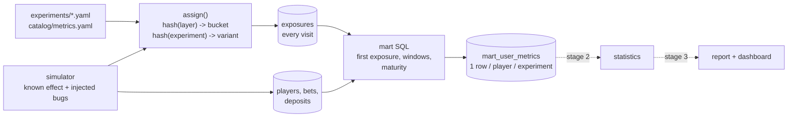

# Gamma · an A/B testing platform for an iGaming product

Experiments are decided by numbers, and the numbers are only as good as the plumbing under them:
who was put in which arm, whether that was logged once, whether the window was complete, whether the
metric has the unit that was randomised. Gamma is that plumbing, built so that every claim it makes
can be **checked against a world whose truth is known**.

This first stage covers the data side: experiments as reviewed YAML, deterministic assignment,
an exposure log, ClickHouse marts with one row per player, and a simulator that plants a real
effect, two false alarms and two data-quality bugs for the next stages to find.

> Status: stage 1 of 3. Stage 2 adds the statistics (sample size, SRM, tests, CUPED, simulation
> checks of the methods themselves), stage 3 the report with a ship/don't-ship verdict and dashboards.

## What it shows

| Area | How it is done here |
| --- | --- |
| Experiments as code | One YAML file per experiment: hypothesis, owner, layer, buckets, variants, primary / secondary / guardrail metrics, design (alpha, power, MDE). Loading refuses an unwritten hypothesis, an unknown metric, a first variant that is not `control` |
| Deterministic assignment | The variant is a pure function of (experiment, player): `blake2b` hash, no assignment table, same answer in every service and in an analyst's notebook. A golden test pins known values, because changing the hash silently re-randomises every running test |
| Layers | Experiments that must not share players (two promos) live in one layer and own disjoint bucket ranges of 10,000; the loader refuses overlaps that run at the same time. Experiments in different layers overlap freely and stay independent, thanks to a per-experiment salt (tested with a chi-square on the cross-tab) |
| Metric catalog | `catalog/metrics.yaml`: binary, continuous and ratio metrics defined once, with the pre-period column that CUPED will use |
| Exposure log | Events are logged on every visit, as an app does. The analysis uses the **first** exposure per player, so duplicates are expected, not a bug |
| Marts | `mart_user_metrics`: one row per player per experiment, post-exposure window and pre-exposure window, built by one SQL statement. Rebuilding is idempotent |
| Maturity | Only players whose window is complete at the analysis date are included. Counting a player exposed an hour ago as "did not deposit" biases every rate down |
| Money | Integer cents in the raw tables, no float sums |
| Schema | Ordered SQL migrations with checksums; editing an applied migration is refused |
| Tested against truth | The simulator is the ground truth. The mart is verified against an independent Python recomputation, and the planted effect and bugs are asserted in the data |

## Architecture



## Run it

Requirements: Docker with Compose v2, Python 3.11+.

```bash
make dev && . .venv/bin/activate   # the `gamma` command
make check    # validate experiments and the metric catalog
make up       # ClickHouse, then the schema
make sim      # 200k players, ~6.5M bets, then the marts of all three experiments
make status   # row counts and the arms of every experiment
make e2e      # the end-to-end tests against the running database
```

```text
$ gamma check
6 metrics, 3 experiments, all consistent
experiment      layer   buckets       traffic  primary             hypothesis
cashier_flow    promo   5000-9999     50%      deposit_conversion  A one-page cashier instead of three steps raises 7-day depos...
lobby_layout    lobby   0-9999        100%     bets_per_player     A game lobby sorted by personal history instead of popularit...
welcome_bonus   promo   0-4999        50%      deposit_conversion  Raising the first-deposit bonus cap from 50 to 100 EUR makes...

$ gamma status
welcome_bonus
  control        48937 players  conversion  29.38%  deposit/player   51.05
  treatment      49309 players  conversion  31.57%  deposit/player   54.13

cashier_flow
  control        49569 players  conversion  29.11%  deposit/player   50.89
  treatment      43419 players  conversion  29.43%  deposit/player   49.79
```

Look at the second block before reading anything into the numbers: 49,569 against 43,419
players in a 50/50 test. That is the planted logging bug, and noticing it is stage 2's first check.

## The simulated world

`simulation/scenario.yaml` is the truth; the analysis code never reads it.

| Experiment | What is true | What the analysis must conclude |
| --- | --- | --- |
| `welcome_bonus` | deposit rate x1.12, bet rate x1.04 for treated players | a real, moderate lift of deposit conversion |
| `cashier_flow` | no effect, **but** the new cashier fails to log the exposure for 35% of iOS players | the test is invalid (sample ratio mismatch), whatever its p-value |
| `lobby_layout` | no effect; a config change flipped 0.4% of players to the other arm mid-test | not significant, and the flipped players are excluded and reported |

Players have a latent activity level that drives betting and depositing before and after exposure
alike, so past behaviour predicts future behaviour (CUPED will use that) and money metrics are
heavy-tailed, as in production. Return to player is 96% (tested). Effects are multipliers on a
player's rates from their first exposure on; before it, treated and control players are identical,
which a test verifies by estimating the rate ratio before (1.0) and after (2.0 in that test) exposure.

## How the mart is defined

For each experiment, in one SQL statement (`src/gamma/marts.py`):

1. **First exposure** per player within the enrollment period gives `variant`, `exposed_at` and
   `n_variants` (more than 1 means the player saw several arms, a randomisation bug).
2. Bets and deposits in `[exposed_at, exposed_at + window)` are the metrics; those in
   `[exposed_at - pre_days, exposed_at)` are their pre-period twins.
3. Players with `exposed_at > as_of - window` are left out (an early look at day 10 of a 21-day
   test includes only players with a full window).
4. Players with no bets and no deposits stay as zeros. Dropping them would turn "conversion"
   into "conversion among the active".

## Tests

`make test` runs the unit tests (about 40, a few seconds); `make e2e` and the CI job run the
database tests against a real ClickHouse with a fixed-seed 40k-player world, so results are exact.

| Test | What it proves |
| --- | --- |
| Hash uniformity, split vs weights, traffic vs bucket range | Assignment is uniform and honours 50/50, 90/10 and 25% traffic |
| Same-layer experiments never share a player; cross-layer ones are independent | The layer model works; the per-experiment salt matters (chi-square on the cross-tab) |
| Golden assignments | Nobody changes the hash by accident |
| Config rejects overlapping buckets, unknown metrics, bad variants | A bad definition cannot start a test |
| Same seed gives identical data; RTP is 96%; effect starts at exposure | The simulator is reproducible and the truth is what the scenario says |
| Stored variant equals `assign()` for every row | The data agrees with a recomputation by anyone |
| Mart equals a plain-Python recomputation for 150 players of two experiments | The SQL is right, including windows, pre-period, zeros and cents |
| Early look leaves out immature players; rebuild is idempotent | Windows and reruns behave |
| Planted bug visible in counts; crossover flagged only where injected | The checks of stage 2 will have something real to find |

## Numbers

One 4-core machine, ClickHouse 24.8 in Docker, 200k players (`make sim`):

| Step | Result |
| --- | --- |
| Generate the world | 3.8 s: 6.49M bets, 427k deposits, 973k exposure rows |
| Load into ClickHouse | 14 s |
| Build a mart | 0.6 to 0.8 s per experiment, 388k player rows in total |
| Disk | bets 54.6 MiB, mart 16.1 MiB, exposures 6.5 MiB, deposits 4.1 MiB |

## Limits, on purpose

- **One real effect per scenario.** Events are drawn exactly with one change point per player.
  With two real effects overlapping on a player the generator would be approximate, so the
  scenario refuses it.
- **Only players who see an experiment get events.** The rest cannot influence any result.
- **Exposure is the first logged visit**, not an intent-to-treat on everyone who was bucketed.
  Players bucketed who never visited are not in the data, which is also what production sees.
- **No calendar effects.** Real casinos have weekday and payday seasonality; a full-week window
  (7 days) is used so that the effect is balanced even where seasonality exists.
- The statistics, verdict and dashboards are not here yet.
